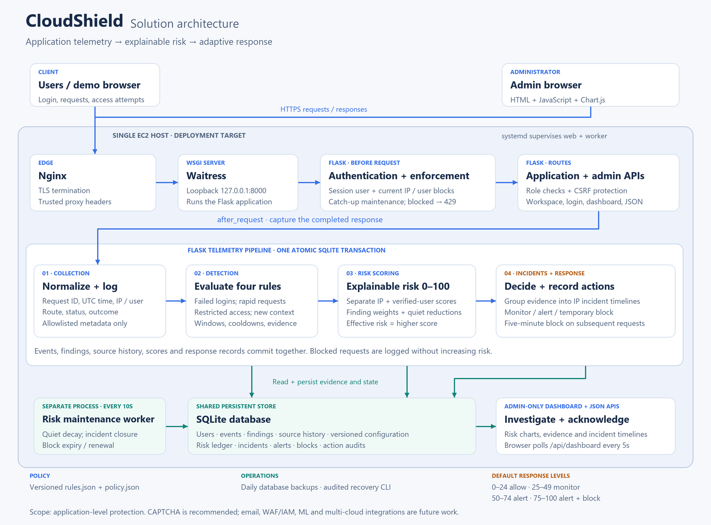
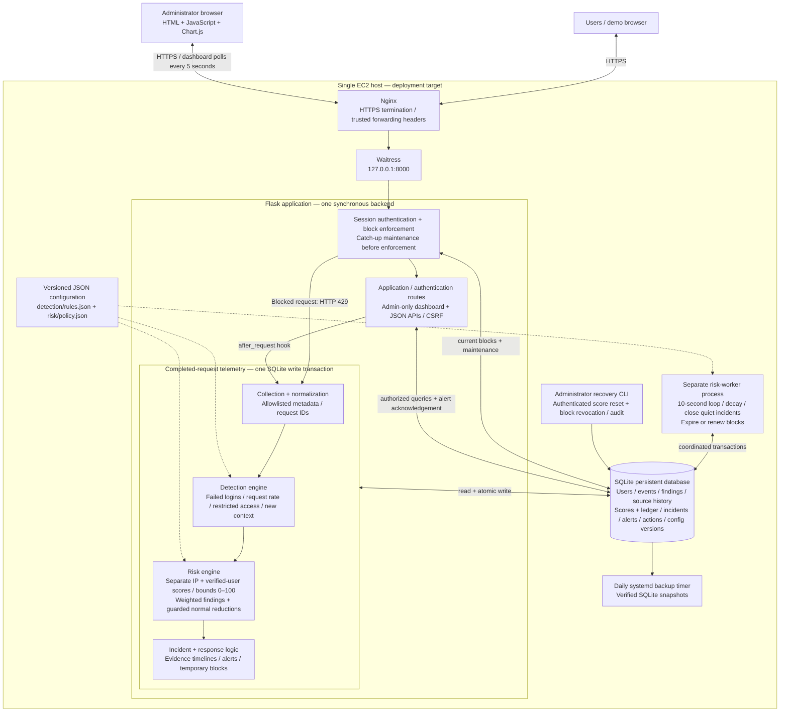

# CloudShield solution architecture

The diagram reflects the implementation in this repository. The single EC2 host is the deployment target supported by `deploy/`; it does not imply that a live deployment has been verified. For local development, Flask's development server replaces Nginx and Waitress.

Download the [vector diagram](architecture.svg) or [PNG](architecture.png). The editable diagram below describes the same components.

- Events, findings, source history, risk changes, incidents and actions commit together. These modules run in-process; the telemetry pipeline does not use a message queue.
- Effective risk is the higher of the IP and authenticated-user scores. Anonymous failed logins affect only the IP. Defaults are low 0–24, medium 25–49, high 50–74 and critical 75–100.
- High and critical escalation creates dashboard alerts. Critical risk creates a five-minute application block enforced on subsequent requests. Blocked traffic is logged without adding findings or risk.
- The separate worker applies −10 per complete five-minute quiet interval, closes incidents after ten minutes without a finding, and handles block expiry or renewal. Request-time catch-up uses the same maintenance logic.
- CAPTCHA is a recommendation. Email, WAF/IAM remediation, ML detection and multi-cloud telemetry are future integrations.

Implementation references: `app/server.py`, `app/__init__.py`, `app/collection/__init__.py`, `app/models.py`, `app/detection/`, `app/risk/`, `app/dashboard.py`, `app/static/dashboard.js`, `migrations/` and `deploy/`.
